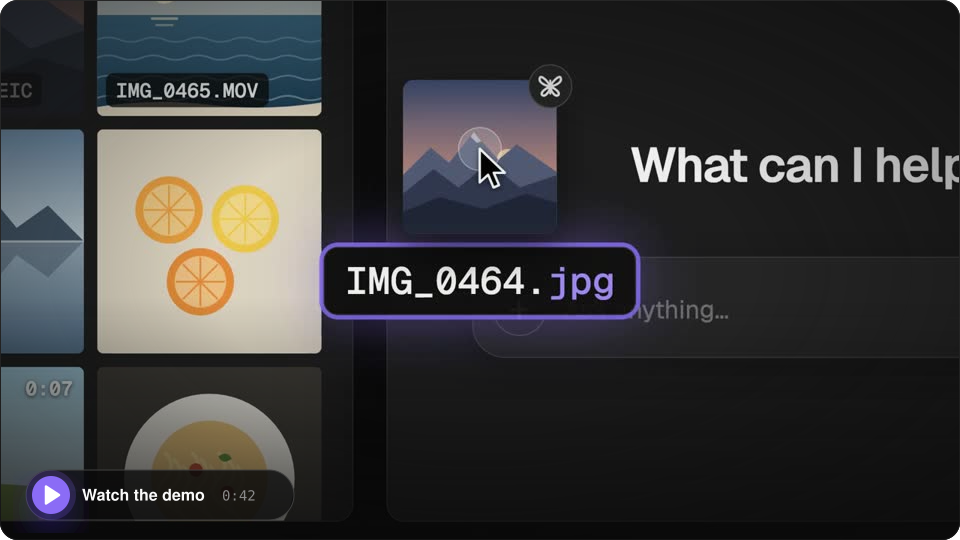
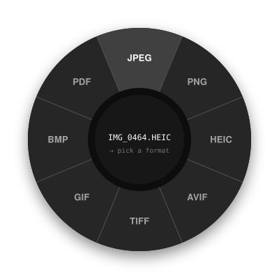
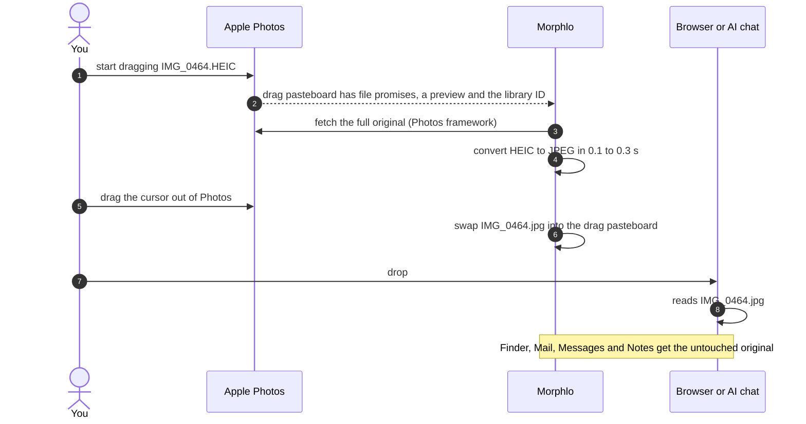

<div align="center">



### Every drag just works. Any file, any format. 100% on your Mac.

[](https://github.com/Mocinjay/morphlo/releases/latest)
[](https://github.com/Mocinjay/morphlo/actions/workflows/ci.yml)
[](https://github.com/Mocinjay/morphlo/releases)
[](#install)
[](#build-from-source)
[](#install)
[](./LICENSE)
[](#100-local)

[Watch](#see-it-in-42-seconds) · [Install](#install) · [Just drag](#just-drag) · [The convert wheel](#the-convert-wheel) · [100% local](#100-local) · [How it works](#how-it-works) · [Website](https://mocinjay.github.io/morphlo) · [Changelog](./CHANGELOG.md)

<br />



</div>

<br />

**Morphlo** is a free, open-source menu-bar app for macOS that makes every drag just work and turns any file into any format, 100% on your Mac. Drag a photo or video out of Apple Photos, Finder, the Desktop or the Dock's Downloads stack into Claude, ChatGPT, Gmail, Dropbox, Slack or any upload box: iPhone HEIC photos arrive as full-quality JPEGs, and videos arrive as the real video instead of a single still frame. Need a different format? A ring of every format the file can become pops up around your cursor.

- **Zero-touch.** No clicks, no pop-ups. Morphlo swaps the file mid-drag, before the destination reads it. Finder, Mail and Messages still get the untouched original.
- **Any file, any format.** Images, video, audio, documents, PDFs and fonts, from a radial convert wheel, a Finder Quick Action, a shortcut or the command line.
- **100% local.** Only what ships with macOS: built-in frameworks plus macOS's own command-line tools. Morphlo never connects to the internet: no accounts, no analytics, no telemetry, no auto-updater.
- **Free & open source.** MIT licensed. Signed and notarized by Apple, so Gatekeeper opens it without security warnings.
- **Native & tiny.** A ~2.5 MB Swift menu-bar app, universal for Apple Silicon and Intel. No ffmpeg, no Homebrew tools, nothing else to install.

## See it in 42 seconds

<a href="https://mocinjay.github.io/morphlo/#video"></a>

<sub>The HEIC that won't upload, the same drag with Morphlo on, the convert wheel, and why nothing leaves your Mac. [Watch on the website](https://mocinjay.github.io/morphlo/#video) or [download the MP4](https://mocinjay.github.io/morphlo/media/morphlo-demo.mp4) (3.6 MB).</sub>

## Install

Requires **macOS 14 Sonoma or later**. Pick one:

**Download** [**Morphlo.dmg**](https://github.com/Mocinjay/morphlo/releases/latest/download/Morphlo.dmg), open it and drag Morphlo to Applications.

**Homebrew:**

```sh
brew tap mocinjay/tap && brew trust mocinjay/tap && brew install --cask morphlo
```

**npx** (downloads the signed app from GitHub Releases and opens it):

```sh
npx morphlo
```

On first launch macOS asks for **Photos** access. Choose **Full Access**: Morphlo needs it to fetch your originals for the automatic fix.

<details>
<summary><b>Optional permissions</b> — what each one unlocks</summary>

<br />

| Permission | What it's for |
|---|---|
| **Photos** (Full Access) | Fetching the full original of a photo or video you drag out of Photos. Required for the automatic fix. |
| **Accessibility** | Spotting AI-chat tabs in browsers, and detecting drags out of the Dock. |
| **Speech recognition** | On-device transcripts for videos sent to AI chats. |
| **Finder automation** | <kbd>⌥</kbd><kbd>⌘</kbd><kbd>K</kbd> on files selected in Finder. |

</details>

<details>
<summary><b>Uninstall</b></summary>

<br />

```sh
brew uninstall --cask morphlo   # if you installed with Homebrew
npx morphlo uninstall           # if you installed with npx
```

Or quit Morphlo and drag `Morphlo.app` to the Trash.

</details>

## Just drag

Photos doesn't hand over real files when you drag. Browsers and Electron apps (the Claude and ChatGPT desktop apps, Slack, Discord…) then take the wrong thing: a `.heic` most sites and AI chats can't read, a shrunken preview, or a single still frame of your video. With Morphlo running you drag as usual, and each destination gets what suits it:

| Drag into | What arrives |
|---|---|
| Browsers, upload boxes, Gmail, Dropbox, Slack, … | A full-quality **JPEG** for photos, the **real video** (every frame and the audio) for videos |
| AI chats — Claude, ChatGPT, Gemini, … | The real video, or **still frames + a contact sheet** if you switch that on in settings |
| Finder, Mail, Messages, Notes | The **untouched original** — they already handle it correctly |
| The Desktop, the Trash, a Finder-type app icon in the Dock | The **real file**, never Morphlo's converted copy |
| Claude's or a browser's icon in the Dock | Same as dropping on that app's window |
| Anywhere inside Photos (e.g. an album) | **Never touched** |

It works the same for drags out of Photos, Finder, the Desktop and the Dock's Downloads stack (or any file kept in the Dock), with an auto-hiding Dock and on multiple displays. A photo is usually ready in 0.1–0.3 s, well before your cursor reaches the other window. If an original lives only in iCloud and iCloud fetching is off, or it isn't ready in time, the drag carries what Photos itself provides.

## The convert wheel

<div align="center">

</div>

Every format a file can become, in a ring around your cursor. Pick one and the converted file appears next to the original. Or replace the original instead (it goes to the Trash). Hold <kbd>⌥</kbd> while picking to do the other one, just once.

| Open it | How |
|---|---|
| **Mid-drag** | Tap <kbd>⇧</kbd> while dragging any file. A round drop disc pops up under your cursor. |
| **Anywhere** | <kbd>⌃</kbd><kbd>⌥</kbd><kbd>M</kbd> opens the drop disc where your cursor is. |
| **Finder selection** | Select files and press <kbd>⌥</kbd><kbd>⌘</kbd><kbd>K</kbd>. |
| **Right-click** | Right-click files in Finder → **Quick Actions** (or **Services**) → **Convert with Morphlo**. |
| **Menu bar** | Click the butterfly to open the drop disc. Right-click it for settings and **Convert a File…** |
| **App icon / shelf** | Drop files on Morphlo's app icon, or click any file on Morphlo's shelf. |

Both shortcuts can be changed under right-click the menu-bar butterfly → **Shortcuts**.

| From | To |
|---|---|
| **Images** — HEIC, JPEG, PNG, TIFF, RAW, … | JPEG, PNG, HEIC, AVIF, TIFF, GIF, BMP, PDF |
| **Video** — MOV, MP4, M4V, 3GP, … | MP4 (H.264), MP4 (HEVC), MOV (ProRes), animated GIF, audio only |
| **Audio** — M4A, MP3, WAV, AIFF, FLAC, CAF, … | M4A (AAC), M4A (HE-AAC), WAV, AIFF, FLAC, ALAC (Apple Lossless) |
| **Documents** — Markdown, Word, ODT, RTF, HTML, TXT | PDF, DOCX, DOC, ODT, RTF, TXT, HTML |
| **PDF** | PNG or JPEG per page, DOCX / ODT / RTF / TXT (text) |
| **Fonts** — TTF, OTF, WOFF, WOFF2 | WOFF2, WOFF, TTF / OTF |

<sub>Formats macOS can't encode by itself — MP3, WebM, MKV, OGG, WebP — aren't offered as outputs.</sub>

## 100% local

- **Only what ships with macOS.** Every conversion uses built-in frameworks — ImageIO, AVFoundation, Core Audio, PDFKit, TextKit, Photos, Apple's Brotli and on-device Speech — plus macOS's own `afconvert` and `textutil`. Morphlo never calls Homebrew tools and bundles no binaries.
- **Never touches the network.** Verified with zero open sockets. No accounts, no analytics, no telemetry, no auto-updater.
- **iCloud is opt-in.** If you use iCloud Photos with "Optimize Mac Storage", you can let macOS fetch originals that live only in iCloud (right-click the menu-bar butterfly → **Get originals from iCloud Photos when needed**). It's **off by default**.
- **Transcripts stay on your Mac.** Optional video transcripts use on-device speech recognition.

## How it works

When you drag out of Photos, it doesn't hand over real files. It hands over **file promises** ("ask me and I'll export the original") plus a small preview. Chromium's macOS drop code, used by Chrome and by Electron apps, never asks for the promise and takes the preview instead. That's why HEIC or a downsized JPEG arrives, and why a video becomes its poster frame.

Every drag out of Photos also carries the item's library ID. The moment a drag starts, Morphlo:

1. fetches the full original from your library through Apple's Photos framework;
2. converts it: HEIC becomes JPEG, a video stays the real file;
3. swaps the fixed file into the drag pasteboard once the cursor leaves Photos, before the destination reads it.



**Drags out of the Dock** are trickier. The Dock gives every drag its own randomly named, private pasteboard, so Morphlo can't see it by watching the shared one. While such a drag is in flight, Morphlo keeps a tiny, practically invisible "sniffer" window under the cursor. The moment the drag touches it, Morphlo learns the pasteboard's name and hands it to the same auto-fix path. The window never accepts the drop and disappears as soon as it has the name.

<details>
<summary><b>Settings</b> — right-click the menu-bar icon</summary>

<br />

- Convert wheel: keep the original (save a new file) or replace it (original goes to the Trash)
- Automatic fix on / off
- Videos for AI chats: send the full video, or still frames + a contact sheet
- Frame count and transcripts
- Photo size
- Clipboard HEIC fix
- Shelf pop-up when dragging photos and videos
- Get originals from iCloud Photos when needed (off by default)
- Shortcuts, launch at login, open log

</details>

## How it compares

| | **Morphlo** | [Clop][clop] | [Dropover][dropover] |
|---|:---:|:---:|:---:|
| Free / open source | ✅ MIT | ~ GPLv3 source, paid app | ❌ paid, closed source |
| Fixes Photos → browser / AI-chat drags automatically | ✅ | ~ | ~ |
| Radial convert wheel | ✅ | ❌ | ❌ drag shelf |
| Only what ships with macOS (no bundled tools) | ✅ | ❌ bundles tools like ffmpeg | ~ |
| Fully offline | ✅ | ~ | ~ |

<sub>✅ yes · ~ partial or unclear · ❌ no. As of Nov 2026, from each project's public docs — wrong? Open a PR.</sub>

[clop]: https://lowtechguys.com/clop/
[dropover]: https://dropoverapp.com/

## Command line

The app binary doubles as a CLI:

```sh
/Applications/Morphlo.app/Contents/MacOS/Morphlo --convert-to jpg IMG_0001.HEIC     # any-format conversion
/Applications/Morphlo.app/Contents/MacOS/Morphlo --targets clip.mov                 # list format ids for a file
/Applications/Morphlo.app/Contents/MacOS/Morphlo --convert IMG_0002.MOV --out ./ai  # AI-friendly: frames + contact sheet
```

| Flag | Does |
|---|---|
| `--convert-to <id> <file>` | Converts `<file>` to the format `<id>` (e.g. `jpg`), next to the original |
| `--targets <file>` | Lists the format ids `<file>` can be converted to |
| `--convert <file> --out <dir>` | Writes an AI-friendly version (still frames + a contact sheet for videos) into `<dir>` |

## Build from source

Needs a Swift 6 toolchain (Xcode 16 or later).

```sh
./scripts/build-app.sh                 # universal build/Morphlo.app, signed with your best local identity
VERSION=0.1.4 ./scripts/release.sh     # Developer ID sign, notarize, staple, zip (see the script header)
```

## Troubleshooting

The log is at `~/Library/Logs/Morphlo/morphlo.log` (right-click the menu-bar butterfly → **Open log**). It records what each drag carried (types, not file paths) and every conversion. Please attach it to bug reports.

<details>
<summary><b>A drag still arrives as HEIC or a still frame</b></summary>

<br />

- Check that Morphlo has **Photos** access with **Full Access** (System Settings → Privacy & Security → Photos).
- If the photo lives only in iCloud ("Optimize Mac Storage"), turn on right-click the menu-bar butterfly → **Get originals from iCloud Photos when needed**, or download the original in Photos first.
- For AI-chat tabs in a browser, grant **Accessibility** so Morphlo can tell them apart.
- Make sure the automatic fix is on in the right-click menu.

</details>

<details>
<summary><b>⌥⌘K does nothing</b></summary>

<br />

Allow Morphlo to control **Finder** under System Settings → Privacy & Security → Automation.

</details>

## Credits

The convert-any-file engine is adapted from [Convert](https://github.com/newtonstudios/convert) by eliasdesena (MIT). See [THIRD_PARTY_NOTICES.md](./THIRD_PARTY_NOTICES.md).

## Contributing

Bug reports and pull requests are welcome — see [CONTRIBUTING.md](./CONTRIBUTING.md). Found a security issue? See [SECURITY.md](./SECURITY.md). Release history is in [CHANGELOG.md](./CHANGELOG.md).

## License

[MIT](./LICENSE)
